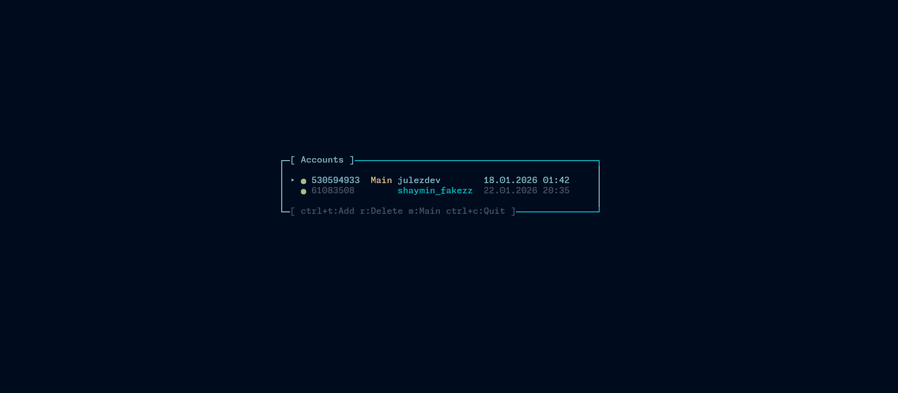
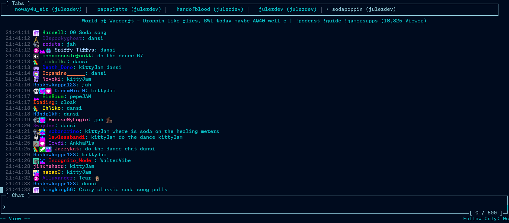
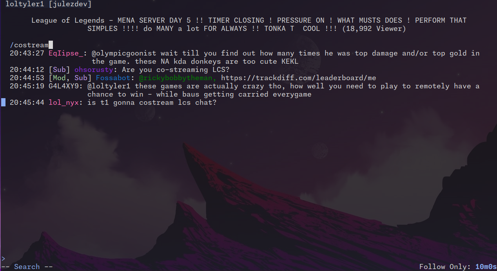
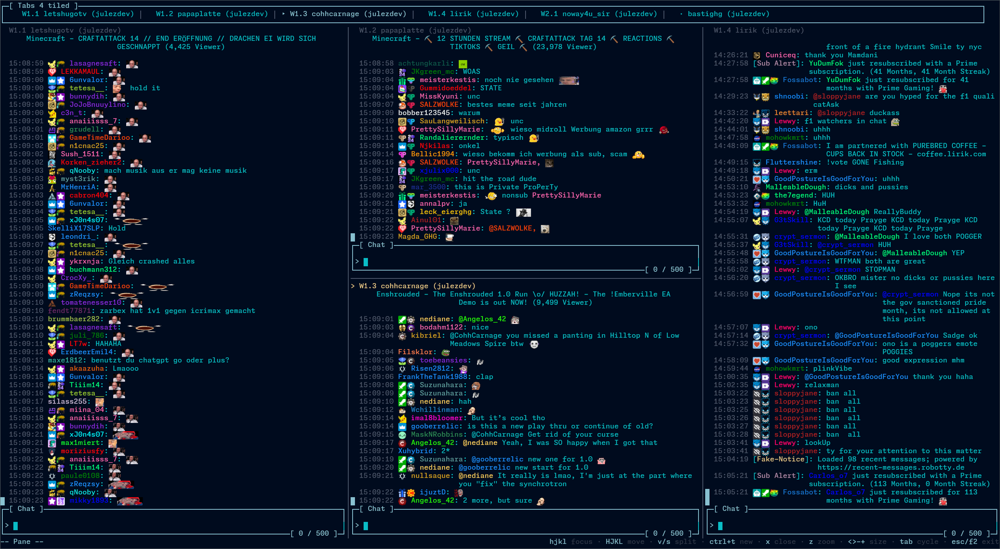
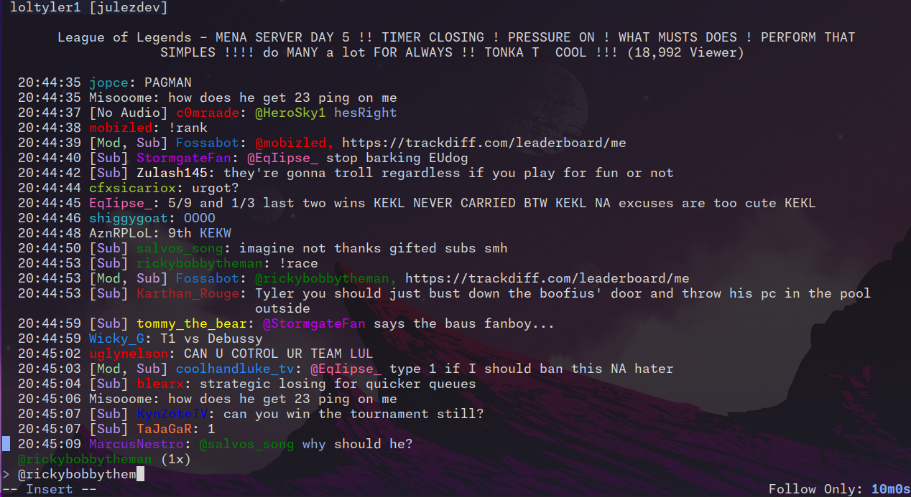
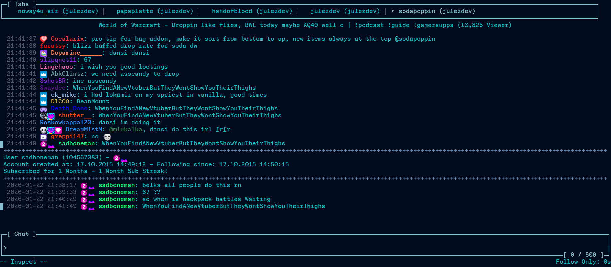
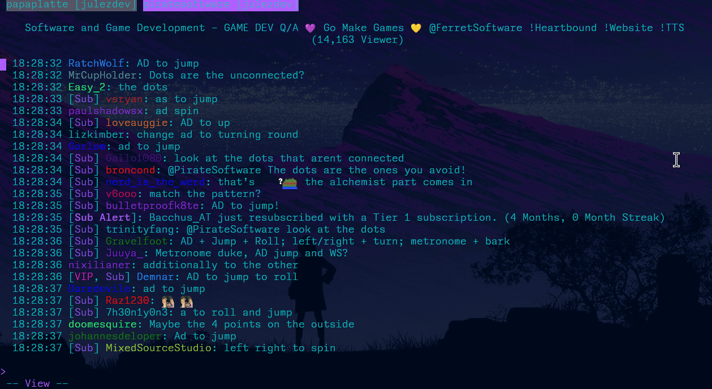

# Features

## Account Management

Chatuino allows you to manage multiple accounts in addition to an anonymous account, which lets you view chat without logging in.



## State Persistence

Chatuino saves your open tabs when you exit the application. When you restart, it attempts to restore your last session, including the tiled layout, split proportions, and focused tab. Older saved sessions without a layout still open in the single-tab view.

Chatuino is designed for users who monitor multiple channels simultaneously over extended periods.

## Chat

Chatuino displays various Twitch events including messages, sub-gifts, timeouts, announcements, and polls in your own chat.

Use local commands like `/localsubscribers` and `/uniqueonly` to filter chat locally.

Press `/` to search chat messages. Navigate results with arrow keys, press Enter to jump to a match, or Escape to cancel.

### Search Syntax

By default, typing a term searches both message content and usernames. Use prefixes to target specific fields or apply advanced filters:

| Filter | Description |
|---|---|
| `hello` | message or username contains "hello" |
| `content:term` | message content contains term |
| `user:term` | username contains term |
| `badge:name` | user has badge (e.g. `badge:moderator`) |
| `is:mod` | mod messages only (also: `sub`, `vip`, `first`) |
| `/pattern/` | regex on content and username |
| `regex:pattern` | regex on content and username |
| `user:/pattern/` | regex scoped to username only |
| `content:/pattern/` | regex scoped to content only |
| `-filter` | negate any filter (e.g. `-user:nightbot`) |
| `"quoted value"` | match a phrase with spaces |

Multiple filters are combined with AND. For example, `user:julez content:GG is:sub` matches messages from "julez" containing "GG" that are from a subscriber.

Aliases: `msg:` for `content:`, `from:` for `user:`.

Enable insert mode (for writing messages/commands) with `i` or Enter, and exit with Escape. Press Enter to send a message, or Alt+Enter to send while keeping the text in the input.
A simple duplication bypass is included when your message matches the last message.
Copy a message to your input by pressing `y` or Alt+C on the message. Copy the selected message to the system clipboard with `Y` or Alt+Y (uses OSC 52, which also works over SSH if the terminal allows it). Reply with `r` or Alt+R. Replies show the message they answer above them, attributed to its author (`↩ alice: that was a great play`) with the text cut to the pane; click the reference to jump to the parent when it is still in the buffer. Twitch's own `@name` prefix is dropped from the reply text, since the reference already names the author. Turn the reference off with `chat.reply_context`.

Press `g`, `t`, or Home to jump to the top of the buffer and `G`, `b`, or End to jump to the bottom. Scroll a page with PgUp/Ctrl+U or PgDn/Ctrl+D.
While you are not caught up with the newest message, a `↓ 3 new messages` badge at the bottom of the chat counts what arrived in the meantime; click it, or press `G`/`b`/End, to jump to the newest message. Panes and inspect windows use the same chat buffer, so the badge behaves the same in all of them.

Switch tabs with Tab/`]`/Ctrl+N and Shift+Tab/`[`.

Press `?` to view all key bindings.





## Tiled Workspace

Display several tabs at once without opening additional Chatuino instances. The normal single-tab presentation remains the default; only an explicit split adds another pane.



1. Open the tabs you want to monitor.
2. Press **F2** to enter pane mode. The status line shows a themed `-- Pane --` indicator with compact, adaptive key hints.
3. Press **v** for a left/right split or **s** for a top/bottom split. The key fixes the direction of that split; **Ctrl+T** instead inherits the focused pane's row or column, so inside a vertical stack the new pane opens below.
4. Choose an open, unassigned tab, or choose **Open a new tab…**. Enter confirms; Escape cancels without changing the layout.
5. Use arrows or **h/j/k/l** to focus panes. Press **Escape** or **F2** to leave pane mode and interact with the focused tab.

Splitting follows i3's container model: a pane whose container already splits along the requested axis joins that container as an equal sibling, so adding a third chat to a row gives three equal columns instead of nesting smaller splits. Splitting along the other axis wraps the focused pane in a new container. Pane mode also supports **H/J/K/L** to move the focused pane. A move swaps with the nearest neighbour in that direction; at the edge of a nested container the pane moves one level up the tree and becomes a sibling of that container, like i3 lifting a window out of its container. A move at the root container's edge is refused, as is any move that cannot satisfy the pane minima. Use **</>** to shrink/grow width, **-/+** to shrink/grow height, **z** to zoom, and **Tab/Shift+Tab** to cycle panes. See [pane controls](SETTINGS.md#pane-controls) for configuration and the full mapping.

- Channel, Mention, and Live Notification tabs can all occupy panes. Each tab appears at most once. **Tab/Shift+Tab navigate without changing the layout:** an assigned tab focuses its pane and automatically shows the workspace that owns it; an unassigned tab opens as a full-screen standalone view while every workspace stays intact behind it. Clicking a tab only activates it; it never assigns it to a pane.
- **x in pane mode hides a pane, not its tab.** Its draft, reply, history, and local modes remain available. The final pane cannot be hidden. The normal close-tab command remains separate and runs the tab's normal cleanup.
- Each chat has its own composer. Only the focused tab receives keyboard input. Click a pane to focus and interact with it; wheel-scroll another pane without changing the typing destination. Normal notification indicators are acknowledged on focus, not merely because a pane is visible. While a composer is active, Tab is handled by suggestion completion; while chat search is active, Tab stays in search instead of changing tabs.
- Tiled panes show their channel/tab and account identity, with a `>` marker on the focused pane. Pane headers use the same `Wn.pane` label. The tab list always shows every tab and marks workspace tabs as `W1.1`, `W2.3`, and so on (workspace and pane), with `·` for standalone tabs. Tab entries follow pane reading order, so moving a pane also moves its tab entry; standalone tabs stay after workspace tabs in their original relative order. Its border shows `N tiled` or `standalone`. Help/account/join dialogs cover the workspace rather than opening inside one pane.
- New splits rebalance their container equally (1/N each, like adding a window to an i3 container); a split that changes the axis wraps the focused pane and starts 50/50. Resizing moves the divider next to the focused pane in five-percentage-point steps, and removing a pane keeps the survivors' relative shares. Panes need at least **24 columns × 8 rows**, including pane chrome, with extra space for separators and the global tab list/status.
- **z** temporarily shows the focused pane across the workspace. Navigation stays zoomed; successful layout edits return to tiling. Zoom is not saved across restarts.
- If a terminal resize makes the layout too small, `SMALL TERMINAL` indicates a temporary focused-pane view. The full layout returns when it fits again. You can navigate or close panes in this state, but cannot split, move, or resize an unseen layout.
- Detached `--tab` sessions may be tiled in memory but still never read or write saved session state.

Mouse dragging, moving whole subtrees to an arbitrary target, and duplicate views of one tab are not supported.

### Multiple Workspaces

Workspaces are created automatically; there is no workspace picker and no separate workspace selection:

- Every tab stays in the normal tab list, regardless of which workspace owns it.
- Press **F2** on a standalone tab to create or reuse an empty workspace, make that tab its first pane, and enter pane mode. Pressing **F2** on a tab already in a workspace enters that workspace's pane mode. Pressing **F2** on another standalone tab creates another workspace when no empty workspace can be reused.
- Tab/Shift+Tab and tab clicks automatically switch to the workspace that owns the selected tab. A standalone tab opens full-screen and leaves the current workspace untouched.
- Use **Ctrl+T while in pane mode** to add a new tab directly to the current workspace as a new pane. Its direction is inherited from the focused pane's container (a row adds to the right, a stack adds below); **v**/**s** override it for that split. Use **Ctrl+T outside pane mode** for a standalone tab.
- The tab list shows ownership as `W1.1`, `W2.2`, etc.; standalone tabs show `·`.
- A tab belongs to at most one workspace. Opening the same broadcast in another workspace means creating a separate tab there, with its own draft, history, selection, and pane membership. Backend connections and caches can still be shared.
- Workspace layouts, focus, tab order, and the tab collection order restore with the saved session. Older single-layout state opens as `W1`. Empty workspaces are reused and detached sessions never load or save workspace state.


## Mouse

Mouse support is enabled by default and can be disabled with `mouse: false` in `settings.yaml`.

- Click a tab to switch to it.
- Click a chat message to select it, then use copy, reply, or timeout shortcuts.
- Double-click a chat message to inspect its author.
- Click the message input to start typing.
- Use the wheel to scroll chat.
- In vertical tab mode, the wheel switches to the previous/next tab.

Hold `shift` while dragging to use the terminal's native text selection.

## Auto-Completion

Chatuino provides auto-completion for channel names when joining new chats, usernames in chat, and emotes.

Commands like `/ban`, `/unban`, and `/timeout` are also suggested.

## Moderation Commands

Moderators can use `/timeout`, `/ban`, `/unban`, `/announcement`, `/marker`, `/delete_all_messages` and `/clear` from the message input.

Chat settings can be changed from the same input: `/slow [duration]`, `/slowoff`, `/followers [duration]`, `/followersoff`, `/subscribers`, `/subscribersoff`, `/emoteonly`, `/emoteonlyoff`, `/uniquechat` and `/uniquechatoff`. `/slow 10` means ten seconds, `/followers 10m` means ten minutes, and leaving the duration out uses Twitch's default. The status bar updates as soon as Twitch confirms the change.

Moderators and VIPs are managed with `/mod`, `/unmod`, `/mods`, `/vip`, `/unvip` and `/vips`. Warnings use `/warn <user> [reason]`. Raids use `/raid <channel>` and `/unraid`, shoutouts use `/shoutout <channel>`, and the next automatic ad can be pushed back with `/snooze`.

Held AutoMod messages appear as chat notices with their message ID; approve or deny them with `/approve <message_id>` and `/deny <message_id>`, or select the notice and press `alt+a` / `alt+d` to have the command typed into the composer. Warnings, shoutouts and AutoMod status changes are also rendered in chat.

### Unban Request Queue

Press `alt+u` or run `/unbanrequests` to open the unban request queue for the current channel. Each entry shows the user, request text, status and when it was created.

Use `h`/`l` or the left/right arrow keys to switch between pending, approved, denied, acknowledged, canceled and all requests. Resolved requests also show the moderator and optional resolution text. Use `j`/`k` or the up/down arrow keys to select a request, `a` to approve it, and `d` to deny it. Only pending requests can be approved or denied. Approving or denying opens a resolution input where you can optionally add a message for the user; press Enter to submit or Escape to cancel. Press `r` to refresh the queue and Escape again to close it.

The queue listens to `channel.unban_request.create` and `channel.unban_request.resolve`, so new requests and resolutions appear without a manual refresh. A failed refresh or resolution keeps the current queue visible so you can retry. The feature is available to moderators and broadcasters only.

`/timeout` takes its duration the way Twitch's own chat does, so it does not need to be converted to seconds first:

- `/timeout alice 10m spam` - ten minutes
- `/timeout alice 1h30m spam` - combined units of `s`, `m`, `h`, `d` and `w`
- `/timeout alice 600 leftovers from web chat` - a bare number is seconds
- `/timeout alice spam without a duration` - refuses instead of guessing; the duration is positional
- `/timeout alice 10m spam and hate` - everything after the duration is the reason
- `/timeout alice` - ten minutes, the same default Twitch uses

The API caps a timeout at two weeks, so anything longer is rejected before a request is sent. `/ban` stays permanent: it never sends a duration.

Accept the highlighted suggestion with Tab, Ctrl+Space, or the right arrow. In the join modal, Tab moves between fields, so the channel input also accepts Space (channel names cannot contain spaces).



## User Inspection

Inspect individual chatters to view all their messages (that you've seen), follow age, and subscription status.

Fuzzy search is supported. Start user inspection with Ctrl+L or the `/inspect username` command. Chatuino also displays all messages that mention the user.

Chatuino only shows messages you've seen, but every message can be persisted locally when configured in settings, allowing you to maintain a local log of all chats you visit. See [settings](SETTINGS.md) for details.



## Emotes

Chatuino can display emotes as text or graphical images, depending on terminal and OS. See [settings](SETTINGS.md) for details.



## Tab Types

Chatuino offers three tab types when creating a new tab with Ctrl+T:

- **Channel**: The default tab type. Join a specific channel/broadcaster, similar to the normal web chat.
- **Mention**: Displays all messages from open Channel tabs that mention one of your configured users. A bell icon in the tab name indicates new mentions.
- **Live Notification**: Notifies you when channels in open tabs go online or offline. A bell icon appears next to the tab when a channel goes offline.

## CLI Tab Flags

You can open Chatuino with specific tabs using the `--tab` flag. Each `--tab` specifies a single tab to open. When `--tab` is used, Chatuino runs in detached mode: state is not loaded from or saved to disk, allowing multiple independent instances.

### Syntax

| Format | Description |
|---|---|
| `--tab channel` | Open a channel tab with the default account |
| `--tab user@channel` | Open a channel tab with a specific account |
| `--tab anonymous@channel` | Open a channel tab as anonymous (read-only) |
| `--tab notification` | Open a live notification tab |
| `--tab mention` | Open a mention tab |

### Examples

```
chatuino --tab streamer1 --tab streamer2
chatuino --tab myuser@streamer1 --tab notification
chatuino --tab anonymous@streamer1 --tab streamer2
chatuino --tab notification --tab mention --tab user1@streamer1
```

Notification and mention tabs are singletons; duplicates are ignored. The mention tab requires at least one non-anonymous account.
